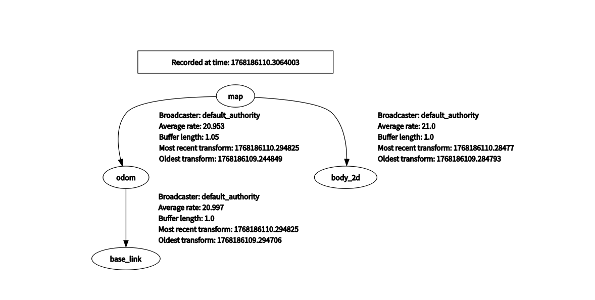

**##0、功能包说明##**
1.先配置主机网口ip为固定ip，
然后配置/home/zy/nav/ros2_humble_main/src/driver/livox_ros_driver2/config/MID360_config.json中的hostip为固定ip，雷达ip自查一般为1+序列号后两位。

**##1、功能包说明##**

car_vel: 底盘驱动 整体运行launch控制
launch包： 导航启动launch文件，建图启动launch文件，launch控制文件（通过websocket启动导航和建图launch文件，主要给前端使用）
car_vel包: 底盘驱动 底盘控制
motor_websocket.py 连接底盘串口，发送控制指令，接收websocket消息，用于外部控制底盘移动。
map_body2d.py 发布 map-body_2d的tf变换，用于将机器人的位置转换到平面。给pointcloud_to_laserscan使用。
publish_initial_pose.py 发布机器人初始位置 0 0 0，触发icp在导航程序启动时初始化机器人初始位姿。

driver:  设备资源处理
livox_ros_driver2 --- 获取mid360雷达点云 发布原始点云，给point_lio使用，主要针对点云数据包时间戳做了简单修改。

interface:  pointlio自定义接口

lio：    建图算法
FAST_LIO --- fast_lio建图 目前未使用
fastlio2 --- 备用测试方案，目前未使用
point_lio --- small_point_lio建图(使用中)，
1.获取原始点云数据（custom_pointcloud_type)发布pointcloud2数据，给octomap_server、pointcloud_to_laserscan、icp使用。
2.发布odom-base_link的tf变换，充当里程计功能，

mapper:  二维、三维栅格建图以及点云处理
octomap_server2 --- 在/octomap_full、/octomap_binary上发布三维栅格图，同时在/project_map上发布二维栅格图（使用中）
pcd2pgm --- 用于读取点云的pcd文件，并在/map上发布二维的栅格图（未使用）
pointcloud_to_laserscan --- 将mid360的点云数据转换成的激光雷达数据，用于导航（使用中）

navigation：导航包以及导航相关算法
robot_navigation2 --- 使用navigation2进行导航（使用中）

registration:    定位算法
amcl_registration --- 使用amcl进行定位（未使用）
icp_registration  --- 使用icp进行定位（使用中）

**##2、编译##**
1.先编译雷达驱动
colcon build --symlink-install --cmake-args   -DROS_EDITION=ROS2   -DHUMBLE_ROS=humble --packages-select livox_ros_driver2
2.然后编译interface
colcon build --packages-select interface lzp_interface
3.然后再编译其他包
 colcon build --symlink-install 

**##3、运行##**
3.1 -- 建图

命令：
ros2 launch car_vel mapping.launch

3.2 -- 保存地图
命令:
ros2 service call /map_save std_srvs/srv/Trigger
保存pcd文件到目录 /home/zy/nav/ros2_humble_main/src/lio/small_point_lio/pcd，主要给icp重定位使用。
需要手动拷贝到/home/zy/nav/ros2_humble_main/src/navigation/robot_navigation2/pcdmaps，或者改icp的配置文件
icp.yaml在registration下面的、config中

命令:
ros2 run nav2_map_server map_saver_cli -t /projected_map -f /home/a/nav_ws/src/ros2_humble_main/src/navigation/robot_navigation2/maps/map
保存pgm文件，map是地图名称，

3.3 -- 导航
命令：

ros2 launch car_vel car_vel.launch.py

**##其他##**
ros2有很多topic，刚开始学时被弄的头晕了，网上找来找去，始终不知道什么是/map,/odom,/base_link，等
他们之间谁能继承谁，谁链接谁一点都不懂，也不知道该如何链接mid360的livox_frame以及其他的，
最后经历了大量的寻找以及实验，才知道导航topic链接是这样的
/map -> /odom -> base_link -> livox_frame(或者其他雷达的link)

其中/map -> /odom 的tf关系是由 各种 SLAM算法发布的，例如icp、amcl
/odom -> /base_link 的tf关系是由各种lio算法发布的，例如fast_lio,point_lio

对于mid360的点云数据来说，还需要进行
/base_link -> livox_frame 的tf变换，是由 pointcloud_to_laserscan 算法发布的

如果需要用octomap进行点云处理，则需要将octomap_server_launch.py中的
DeclareLaunchArgument('pointcloud_min_height', default_value='-0.12'),    #机器人高低度 单位m
DeclareLaunchArgument('pointcloud_max_height', default_value='0.35'),    #机器人低高度 单位m
这两句按照实际情况更改，与上述的与thre_z_max、与thre_z_min保持一致

对于pointlio，输出的点云默认在雷达坐标系，livox_frame,这个其实和odom是相同的，在别的项目也叫camera_init,也就是雷达的初始位置（odom），所以这个不要和baselink做变换。变换之后icp就不准了，可以单独定义个雷达坐标系，不要和livox_frame重名，用自己定义的坐标系表示雷达在底盘的位置。
这是当前的tf，相对于源项目少了livox_frame，

对于body_2d,是机人的平面坐标系，ros2_humble_main/src/mapper/map_body2d.py发布。

整体流程
driver发布原始点云，pointlio获取原始点云，转换成pointcloud2数据发布（已转换到baselink下），同时发布odom-base_link的tf变换，作为里程计功能，
建图时pointlio生成pcd地图，octomapserver生成pgm地图。建图主要依赖pointlio自身的建图功能及点云数据（用于生成2为地图）
导航时，pointcloud_to_laserscan转换成激光雷达数据，发布/scan话题，robot_navigation2订阅/scan话题，进行导航。导航主要依赖
pointlio的点云数据（用于生成二维雷达信息），依赖pointlio的里程计功能，也就是odom-base_link的tf变换，用于实时获取机器人的当前位姿。

fastlio需要修改的地方 
1. fastlio 默认雷达在底盘的中心 需要修改配置文件匹配雷达相对于base_link的坐标系
2. fastlio默认输出的Odometry话题不包含速度信息，需要在源码/src/laserMapping.cpp修改。
同时在nav2的配置文件也要修改Odometry话题名称，默认是/odom
3. 重定位和pointcloud_to_laserscan的配置文件都需要修改，输入的雷达话题为fastlio输出的点云话题: cloud_registered

small_point_lio
1.发布odom到base_link的变换
2.发布pointcloud2数据，用于建图

ros2 service call /map_server/load_map nav2_msgs/srv/LoadMap "{map_url: '/home/a/nav_ws/src/ros2_humble_main/src/navigation/robot_navigation2/maps/map.yaml'}"

colcon build --symlink-install --packages-skip gtsam sophus livox_sdk2

ros2 launch car_vel car_vel.launch.py
ros2 launch car_vel launch_manager.launch.py

cd ~/nav_ws/src/ros2_humble_main/src/car_vel/car_vel/web_frontend
python3 -m http.server 8080 --bind 0.0.0.0

下一步操作步骤：
free -h
cat /sys/class/thermal/thermal_zone0/temp

source /home/a/nav_ws/install/setup.bash && \
RCUTILS_COLORIZED_OUTPUT=0 \
ros2 launch car_vel launch_manager.launch.py 2>&1 | \
tee /home/a/nav_debug_full.log

ros2 bag record -o ceshi \
  /livox/lidar \
  /livox/imu \
  /Odometry \
  /tf \
  /tf_static \
  /cmd_vel \
  /lio_health
